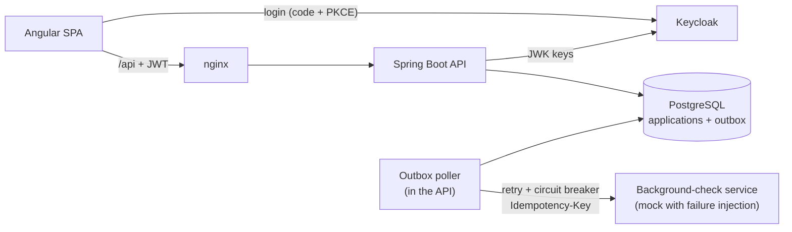

# Onboarding Portal

A full-stack client-onboarding portal for a fictional Swiss insurer. Applicants fill in a
multi-step form and upload their ID. A background check runs against an external service, and two
different caseworkers must approve each application before it is accepted.

**Stack:** Angular 20 · Angular Material · Spring Boot 3.3 (Java 21) · Spring Security (OAuth2
resource server) · Keycloak · PostgreSQL · Liquibase · OpenAPI · Resilience4j · Testcontainers ·
Docker · GitHub Actions · OpenShift

## What it shows

| Topic | Where to look |
|---|---|
| **Contract-first API**: one OpenAPI file generates both the Spring interfaces and the typed Angular client | `api/openapi.yaml`, `backend/pom.xml`, `frontend/ng-openapi-gen.json` |
| **OAuth2 / OIDC with JWT**: Keycloak login (authorization code + PKCE), JWT validated for signature, issuer and audience, roles mapped from the token | `backend/.../config/SecurityConfig.java`, `frontend/src/app/core/auth.service.ts` |
| **Four-eyes approval**: two distinct caseworkers, one rejection is final, no deciding your own application, enforced in the domain *and* by a unique key in the database | `backend/.../domain/OnboardingApplication.java` |
| **Transactional outbox**: the background-check request is stored in the same transaction as the application, so it cannot be lost | `backend/.../domain/OutboxEvent.java`, `backend/.../outbox/` |
| **Failure handling**: retries and a circuit breaker for short outages, exponential backoff in the outbox for long ones, idempotency keys so a retry never runs a check twice, `FOR UPDATE SKIP LOCKED` so several instances never process the same event | `backend/.../outbox/SanctionsCheckClient.java`, `OutboxEventRepository.java` |
| **Secure file upload**: the real file type is read from the file's magic bytes, never from the browser's Content-Type; file names are sanitized | `backend/.../service/FileSignatures.java` |
| **Server-side paging and sorting** with a whitelisted sort and a stable tie-breaker | `ApplicationService.search`, `frontend/src/app/review/review-list.component.ts` |
| **Reusable, responsive UI components**: a drag-and-drop file picker that works as a form control, status chips, and layouts that switch to a phone layout | `frontend/src/app/shared/` |
| **Tests**: domain and service unit tests, Testcontainers integration tests on a real PostgreSQL, Angular unit tests | `backend/src/test`, `frontend/src/**/*.spec.ts` |
| **CI/CD**: build, test and publish images to GHCR on every push to `main`; manifests for OpenShift | `.github/workflows/ci.yml`, `openshift/` |

## Architecture



Application lifecycle:

```
SUBMITTED --check CLEAR/HIT--> IN_REVIEW --2 approvals--> APPROVED
                                         \--1 rejection--> REJECTED
check fails 8 times --> check status ERROR --caseworker retries--> PENDING
```

## Run it locally

Requirements: Docker. For development without Docker: Java 21, Maven 3.9, Node 22.

```bash
docker compose up --build
```

| URL | What |
|---|---|
| http://localhost:8081 | The portal |
| http://localhost:8180 | Keycloak admin (admin / admin) |
| http://localhost:8090/admin/chaos | Failure switches of the check service |

Demo users (development only): `alice` / `alice` (applicant), `carol` / `carol` and `dave` / `dave`
(caseworkers). New users can also register on the login page and become applicants.

A last name of `Blocked` or `Sanctioned` makes the background check report a match.

### Developing one part

```bash
docker compose up postgres keycloak sanctions-mock   # dependencies only
cd backend && mvn spring-boot:run                    # API on :8080
cd frontend && npm install && npm start              # UI on :4200, /api proxied to :8080
```

## Tests

```bash
cd backend && mvn verify          # unit tests + Testcontainers integration tests (needs Docker)
cd mock-check && mvn verify
cd frontend && npm test -- --watch=false --browsers=ChromeHeadless
```

## Design decisions

- **Why an outbox instead of calling the check service inside the request?** The applicant should
  not wait for, or fail because of, a third-party service. Writing the request to a table in the
  same transaction means a crash right after the commit loses nothing; the poller picks it up.
- **Why both Resilience4j retries and outbox retries?** They solve different outages. Three quick
  retries absorb a blip in a few seconds. The circuit breaker stops hammering a service that is
  clearly down. The outbox backs off for minutes and survives restarts, and after the last attempt
  it hands the case to a person instead of retrying forever.
- **Why is the row lock held during the HTTP call?** It is the simplest way to guarantee that two
  backend instances never process the same event. The cost is a database connection held for up
  to a few seconds per event, acceptable at this volume. At higher volume, claim events with a
  status update and a lease timeout instead.
- **Why no CSRF protection?** The API is stateless and reads no cookies: every request must carry
  a bearer token that a cross-site page cannot attach.
- **Why return 404 instead of 403 for someone else's application?** So applicants cannot probe
  which application ids exist.

## Limitations

This is a portfolio project, not production software:

- Keycloak runs in dev mode with demo users and passwords.
- The background-check service is a mock and has no authentication.
- Documents are stored in PostgreSQL; a real system would use object storage with virus scanning.
- No audit log, no e-mail notifications, no data-retention rules.

## Docs

- [docs/DEMO.md](docs/DEMO.md): a 2-minute demo script, including an outage of the check service
- [docs/DEPLOYMENT.md](docs/DEPLOYMENT.md): deploying to the Red Hat OpenShift Developer Sandbox
- [docs/POSTMORTEM.md](docs/POSTMORTEM.md): what worked, what didn't, and what I would change
